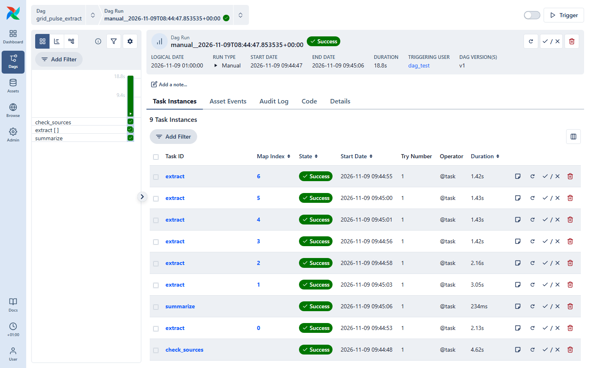
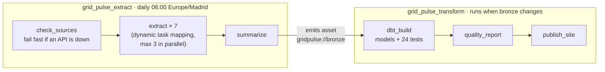
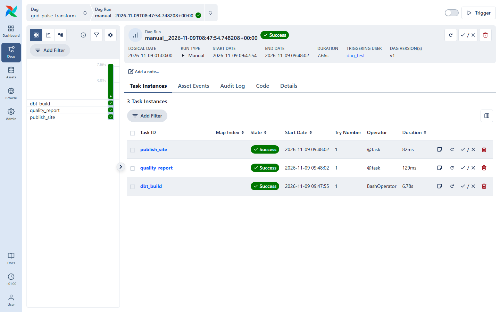

# Grid Pulse on Airflow

[](https://github.com/jonathantorresdata/grid-pulse-airflow/actions/workflows/ci.yml)

Production-style orchestration for [Spain Grid Pulse](https://github.com/jonathantorresdata/spain-grid-pulse) with **Apache Airflow 3**: parallel extraction with one task per source, data-aware scheduling between DAGs, a dbt quality gate before anything is published, retries with backoff, timeouts and failure alerts. Runs locally with Docker Compose; the DAGs are tested in CI.



## The two DAGs



| DAG | Schedule | What it does |
|---|---|---|
| `grid_pulse_extract` | `0 6 * * *`, Europe/Madrid | Checks both APIs, then one mapped `extract` task per source (3 REE datasets, 4 weather points) brings bronze up to date incrementally. On success it emits the `gridpulse://bronze` asset. |
| `grid_pulse_transform` | asset `gridpulse://bronze` | `dbt build` creates every model and runs every test; a failure stops the DAG before the report and the page. Then it logs a quality report and rebuilds the static site. |



## Reliability built in

- **Retries with exponential backoff** on every task, plus an execution timeout so nothing hangs forever.
- **Failure alerts**: every task has an `on_failure_callback` that logs the failure and posts it to a webhook (Slack, Teams…) when `ALERT_WEBHOOK_URL` is set.
- **Isolation**: a failing source is retried on its own; the other six are not downloaded again.
- **Quality gate**: the public page is only rebuilt after all dbt tests pass.
- **Backfills**: extraction uses the run's `data_interval_end`, so `airflow backfill create --dag-id grid_pulse_extract --from-date … --to-date …` rebuilds history the same way the daily run builds today.
- **Enforced by tests**: `tests/test_dags.py` fails CI if a DAG has import errors, or a task has no retries, no timeout or no alert.

### A real failure, and what it taught

The first end-to-end run failed: `dbt build` ran out of memory. Airflow retried, alerted, and kept the page untouched. The pipeline worked on its own, so the difference was the environment: Airflow's environment had resolved DuckDB 2.0, whose JSON schema inference used all 12 GB of RAM. Pinning DuckDB fixed it. [ADR 0004](docs/adr/0004-pin-everything.md)

## Run it locally

Requirements: Docker with Compose, and the pipeline repository cloned next to this one.

```bash
git clone https://github.com/jonathantorresdata/spain-grid-pulse.git
git clone https://github.com/jonathantorresdata/grid-pulse-airflow.git
cd grid-pulse-airflow
docker compose up --build
```

Open http://localhost:8080 (user `airflow`, password `airflow`), switch on both DAGs and trigger `grid_pulse_extract`. The transform DAG starts by itself when extraction finishes.

Without Docker (Python 3.12):

```bash
python3.12 -m venv .venv && source .venv/bin/activate
pip install "apache-airflow==3.4.0" --constraint https://raw.githubusercontent.com/apache/airflow/constraints-3.4.0/constraints-3.12.txt
pip install -r requirements.txt pytest ../spain-grid-pulse
export AIRFLOW_HOME=$PWD/.airflow PYTHONPATH=$PWD GRIDPULSE_HOME=$PWD/../spain-grid-pulse AIRFLOW__CORE__DAGS_FOLDER=$PWD/dags
airflow db migrate
python -m pytest -q tests                                  # DAG integrity tests
airflow dags test grid_pulse_extract 2026-11-09            # full run of a DAG
airflow dags test grid_pulse_transform 2026-11-09
```

## Structure

```
dags/                 grid_pulse_extract.py, grid_pulse_transform.py
include/              shared settings (paths, assets) and the failure alert callback
tests/                DAG integrity tests
docs/adr/             architecture decision records
Dockerfile            official Airflow 3.4 image + dbt-duckdb + DuckDB (pinned)
docker-compose.yaml   Postgres, API server, scheduler, DAG processor, triggerer (LocalExecutor)
```

Decisions: [docs/adr](docs/adr/).
